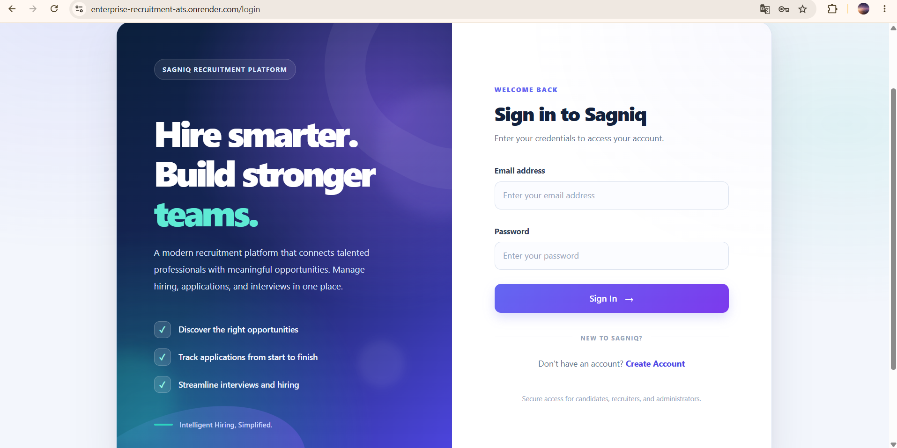
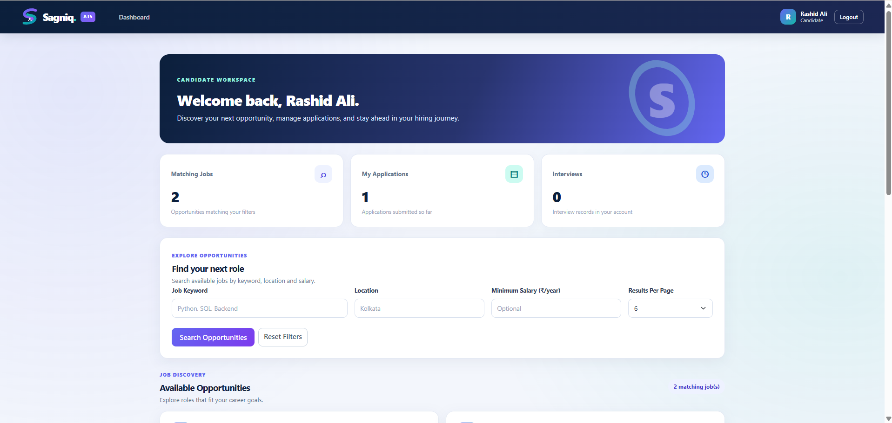
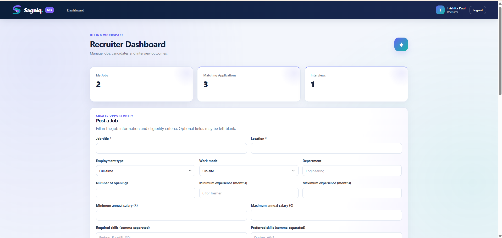
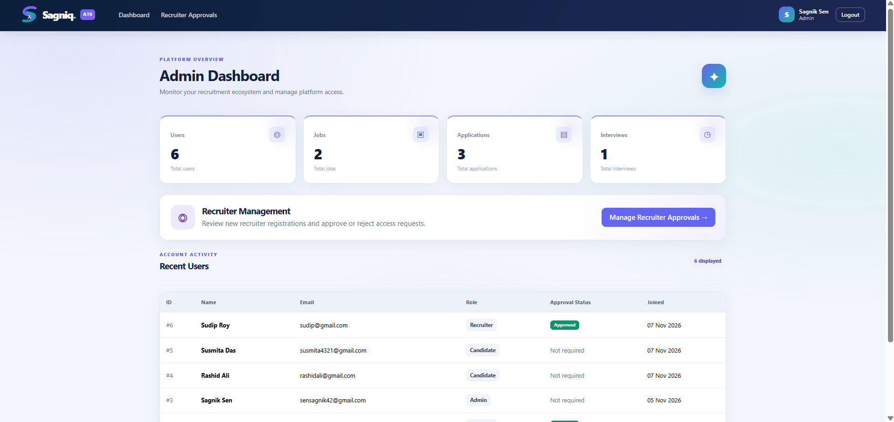
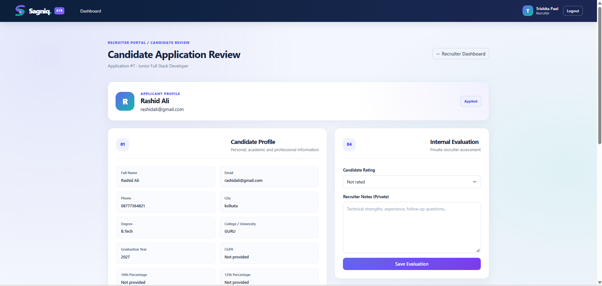
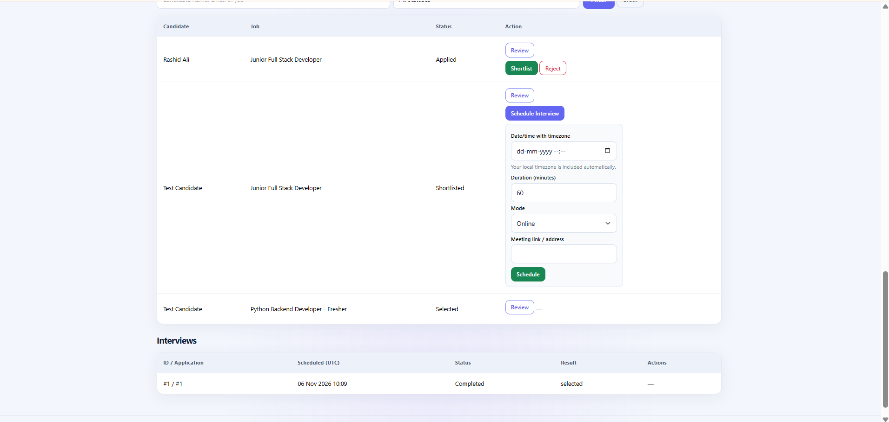

# Sagniq Enterprise Recruitment & Applicant Tracking System

A role-based recruitment management web application built with **FastAPI, SQLAlchemy, MySQL and server-rendered Jinja2 templates**. The system supports the recruitment workflow from job publishing and candidate applications through application review, shortlisting and interview management.

**Live application:** https://enterprise-recruitment-ats.onrender.com  
**Source code:** https://github.com/Sagnik194/Enterprise-Recruitment-ATS

> This README describes the implementation currently present in the repository. It distinguishes the main application-application workflow from the separate Phase 7 profile/resume workflow and does not present proposed Phase 8 hardening integrations as completed features.

---

## Table of contents

- [Project overview](#project-overview)
- [User roles and capabilities](#user-roles-and-capabilities)
- [Application workflow](#application-workflow)
- [Technology stack](#technology-stack)
- [Architecture](#architecture)
- [Security and document handling](#security-and-document-handling)
- [Run locally](#run-locally)
- [Environment configuration](#environment-configuration)
- [Database migrations](#database-migrations)
- [Deployment](#deployment)
- [Tests and continuous integration](#tests-and-continuous-integration)
- [Repository layout](#repository-layout)
- [Known implementation notes](#known-implementation-notes)
- [Future improvements](#future-improvements)

## Project overview

Sagniq Enterprise Recruitment & Applicant Tracking System (ATS) provides separate experiences for candidates, recruiters and administrators.

Candidates can discover open roles, submit applications with their details and documents, and follow application and interview progress. Recruiters can manage their own job listings, review applications belonging to those jobs, evaluate candidates and coordinate interviews. Administrators can review recruiter registrations and view system-level dashboard information.

The application exposes both browser-based pages and a REST API. Browser pages are rendered with Jinja2 templates; the API is built with FastAPI routers and bearer-token authentication.

## User roles and capabilities

### Candidate

- Register and sign in.
- Browse open job listings.
- Search and filter jobs by keyword, location and minimum salary; browse paginated results.
- Submit an application with contact, education, academic, experience and profile information.
- Upload a required PDF resume and an optional PDF certificate in the application submission flow.
- View submitted applications and their current status.
- View interview information and withdraw an application while it is still in the `applied` state.
- Maintain a separate candidate profile and upload a profile resume through the Phase 7 workflow.

### Recruiter

- Register for a recruiter account; access is subject to administrator approval.
- Create job listings and close or reopen jobs they own.
- Review applications submitted to their own jobs.
- Filter application lists and inspect candidate details and submitted documents.
- Save recruiter notes and an evaluation rating for supported application records.
- Shortlist or reject candidates.
- Schedule, reschedule and cancel interviews for shortlisted candidates.
- Record interview outcomes and feedback after the scheduled interview time.

### Administrator

- View dashboard statistics for users, jobs, applications and interviews.
- Review recruiter registrations and approve or reject recruiter accounts.
- Access the user-management functionality provided by the application.

## Application workflow

1. A recruiter creates a job listing.
2. A candidate browses open jobs and submits an application with the requested profile information and PDF documents.
3. The recruiter opens an application associated with one of their jobs and reviews the candidate's details and documents.
4. The recruiter may add notes and a rating, then shortlist or reject the application.
5. For a shortlisted application, the recruiter can schedule an interview, then reschedule or cancel it while it is scheduled.
6. After the scheduled time, the recruiter records the interview result and feedback.
7. The candidate can follow the application and interview status in the candidate-facing pages.

Application status transitions are validated in the application routes; for example, a candidate can withdraw only an application that is still in the `applied` state.

## Technology stack

| Area | Technologies verified in the repository |
|---|---|
| Backend / web framework | Python, FastAPI, Starlette |
| ORM and database | SQLAlchemy, MySQL, PyMySQL |
| Schema migrations | Alembic |
| Data validation / settings | Pydantic, pydantic-settings |
| Browser templates | Jinja2 |
| API authentication | PyJWT, OAuth2 password form |
| Password hashing | pwdlib password hashing |
| Browser sessions | Starlette SessionMiddleware, itsdangerous |
| Document handling | python-multipart, pypdf; Supabase Storage integration |
| Application server | Uvicorn |
| Testing | pytest, HTTPX |
| CI | GitHub Actions |
| Deployment configuration | Render Blueprint (`render.yaml`) |

## Architecture

The codebase is organized around a FastAPI application:

- `app/main.py` creates the FastAPI app, configures browser sessions and middleware, mounts static assets, and includes the API and browser routers.
- `app/routers/` contains API route modules for authentication, users, jobs, applications and interviews.
- `app/web.py` contains the browser-facing recruitment workflows and renders Jinja2 templates.
- `app/models.py` and the phase-specific model modules define SQLAlchemy persistence models.
- `app/database.py` builds the MySQL SQLAlchemy engine and database sessions from environment settings.
- `migrations/` and `alembic.ini` hold the Alembic migration setup.
- `tests/` contains automated tests.
- `.github/workflows/ci.yml` defines the Python test workflow.

The browser interface uses signed session cookies. The JSON API uses bearer JWTs: the token is issued by `/auth/login` and validated by the API dependency layer.

## Security and document handling

The repository currently implements several security controls:

- Passwords are hashed and verified through the password-hashing utility in `app/security.py`.
- API endpoints use signed JWT access tokens with expiry and token-type validation.
- Browser pages use Starlette's signed session middleware and CSRF validation helpers in the browser workflow.
- Role and resource ownership checks restrict recruiter access to their own jobs and applications.
- `SecurityHeadersMiddleware` adds response security headers, including a Content Security Policy.
- The registered `LoginRateLimitMiddleware` applies an in-memory request limit to browser `POST /login` requests.

**Two document workflows exist and use different storage backends:**

1. **Application attachments:** the main application form stores resume and optional certificate PDFs through the Supabase Storage helper. The configured bucket defaults to `candidate-documents`; generated storage keys are kept with application document records. Recruiter document access is checked against ownership of the associated job before a short-lived signed URL is generated.
2. **Phase 7 profile resume:** the separate `/phase7/resume` route writes the candidate's profile resume to a local directory configured by `ATS_RESUME_STORAGE` (default: `private_uploads/resumes`). Downloads are authorized by candidate/recruiter relationship checks.

The Phase 7 local-filesystem upload is not the same as the Supabase-backed application attachment flow. On Render, local filesystem data may not persist across service replacement or redeployment unless a suitable persistent disk is configured. Treat the Phase 7 local resume workflow as requiring a persistence decision before relying on it for production candidate documents.

The current application does **not** implement all proposed Phase 8 controls. In particular, the Phase 8 README's password-fingerprint invalidation, failure-only login guard, strict parsed-PDF validator integration and database audit logging were described as integration steps, not verified active behavior. The current JWT dependency validates token signature/expiry/type and retrieves the user; it does not check a password-version claim. See [Phase 8 security notes](docs/PHASE8_SECURITY_HARDENING.md).

## Run locally

### Prerequisites

- Python 3.12 (the Render Blueprint specifies 3.12.10).
- A reachable MySQL database.
- Git.

### 1. Clone the repository

```bash
git clone https://github.com/Sagnik194/Enterprise-Recruitment-ATS.git
cd Enterprise-Recruitment-ATS
```

### 2. Create and activate a virtual environment

**Windows PowerShell**

```powershell
py -3.12 -m venv .venv
.\.venv\Scripts\Activate.ps1
```

**macOS / Linux**

```bash
python3.12 -m venv .venv
source .venv/bin/activate
```

### 3. Install dependencies

```bash
python -m pip install --upgrade pip
python -m pip install -r requirements.txt
```

### 4. Configure environment variables

Create a local `.env` file in the repository root. Set the required database and JWT values described below. Do not commit this file.

### 5. Apply database migrations

After confirming that the configured database is the intended development database and that its migration history is appropriate:

```bash
python -m alembic upgrade head
```

See [Database migrations](#database-migrations) and the [deployment guide](docs/PHASE9_RENDER_DEPLOYMENT.md) before running migrations against an existing or production database.

### 6. Start the application

```bash
python -m uvicorn app.main:app --reload
```

Open:

- Browser application: http://127.0.0.1:8000
- FastAPI interactive API documentation: http://127.0.0.1:8000/docs
- Health check: http://127.0.0.1:8000/health

The root route redirects to `/login`. The health endpoint checks database connectivity, so it requires a reachable configured database.

## Environment configuration

The following names are read by the current application code.

| Variable | Required | Purpose |
|---|---:|---|
| `DATABASE_HOST` | Yes | MySQL host |
| `DATABASE_PORT` | No | MySQL port; defaults to `3306` |
| `DATABASE_USER` | Yes | MySQL username |
| `DATABASE_PASSWORD` | Yes | MySQL password |
| `DATABASE_NAME` | Yes | MySQL database name |
| `JWT_SECRET_KEY` | Yes | JWT signing secret and local fallback for the browser session secret |
| `JWT_ALGORITHM` | No | JWT algorithm; defaults to `HS256` |
| `ACCESS_TOKEN_EXPIRE_MINUTES` | No | API access-token lifetime; defaults to `30` |
| `SESSION_SECRET_KEY` | No | Dedicated browser session signing secret; falls back to `JWT_SECRET_KEY` if not set |
| `SESSION_HTTPS_ONLY` | No | Set to `true` when browser cookies should be HTTPS-only; defaults to `false` |
| `DATABASE_SSL_MODE` | No | `disabled` by default, or `verify_identity` to enable CA and hostname-verified MySQL TLS |
| `DATABASE_SSL_CA` | Conditional | CA certificate path required when `DATABASE_SSL_MODE=verify_identity` |
| `SUPABASE_URL` | Required for application document storage | Supabase project URL |
| `SUPABASE_SECRET_KEY` | Required for application document storage | Supabase server-side secret key |
| `SUPABASE_STORAGE_BUCKET` | No | Storage bucket; defaults to `candidate-documents` |
| `ATS_RESUME_STORAGE` | No | Local directory for Phase 7 profile resumes; defaults to `private_uploads/resumes` |

Use independently generated secrets for JWT signing and browser sessions in deployment. Never commit real credentials, private keys or production environment files. For MySQL TLS, use `verify_identity` with the provider's CA certificate; do not disable certificate verification in a production deployment that requires TLS.

## Database migrations

Alembic is configured through `alembic.ini` and the `migrations/` directory. The application database engine is configured in `app/database.py`; it reads connection settings from the environment and supports optional CA-verified TLS.

Before applying migrations to an existing database:

1. Back up the database.
2. Inspect the migration history and current database revision.
3. Test the migration chain against a disposable database.
4. Review autogenerated migration scripts before applying them.
5. Do not use `alembic stamp head` as a substitute for creating missing tables.

The repository includes a migration-state check:

```bash
python -m scripts.check_migrations
```

It compares the database's current Alembic revision heads with the migration heads in the repository. It does not create or repair schema objects.

## Deployment

The repository includes a Render Blueprint in `render.yaml`. It specifies a Python web service, installs `requirements.txt`, starts Uvicorn on Render's `$PORT`, and uses `/health` as the health-check path. Automatic deployment is disabled in the checked-in Blueprint.

The Blueprint declares database connection variables and JWT/session settings, but the current file does not declare the Supabase environment variables or the optional MySQL TLS variables. Configure these separately in the Render service if the deployed application uses those features. Review the full [Render deployment guide](docs/PHASE9_RENDER_DEPLOYMENT.md) before changing production configuration.

**Live application:** https://enterprise-recruitment-ats.onrender.com

## Tests and continuous integration

Run the test suite locally:

```bash
python -m pytest -v
```

The GitHub Actions workflow at `.github/workflows/ci.yml` installs the pinned requirements and runs `python -m pytest -v` on pushes and pull requests targeting `main`. The workflow defines test database environment variables but does not start a MySQL service container. Do not assume it validates connectivity to a real MySQL server or production storage.

No current test count or latest CI status is asserted here; consult the repository's Actions tab for the latest run result.

## Repository layout

```text
.
├── app/
│   ├── routers/
│   ├── templates/
│   ├── static/
│   ├── main.py
│   ├── web.py
│   ├── models.py
│   ├── database.py
│   ├── config.py
│   └── security.py
├── migrations/
├── scripts/
├── tests/
├── .github/
│   └── workflows/
│       └── ci.yml
├── docs/
│   ├── PHASE8_SECURITY_HARDENING.md
│   └── PHASE9_RENDER_DEPLOYMENT.md
├── alembic.ini
├── render.yaml
├── requirements.txt
└── README.md
```

This is a high-level guide to the repository; additional modules and phase-specific files are present under `app/`, `migrations/` and `tests/`.

## Known implementation notes

- Browser login rate limiting is currently an in-memory middleware that counts matching login POST requests, rather than only failed authentication attempts. It is not shared across multiple workers or instances.
- API logout instructs the client to remove its access token; the current API token remains valid until its expiry.
- The Phase 7 profile resume is stored locally, while application attachments use Supabase Storage. These storage paths have different persistence characteristics.
- The checked-in Render Blueprint does not list Supabase or MySQL TLS environment variables. Add the required values to the deployment environment when applicable.
- The checked-in README previously contained proposed Phase 8 integration instructions. Those instructions have been preserved as a separate document with implementation status and integration cautions.
## Application Screenshots

### Landing Page


### Candidate Dashboard


### Recruiter Dashboard


### Admin Dashboard


### Application Review


### Interview Management


## Architecture

See [System Architecture](docs/ARCHITECTURE.md).
## Future improvements

Potential next steps, subject to implementation and testing:

- Move all candidate document workflows to a consistent private, persistent object-storage backend.
- Replace in-memory login throttling with a distributed rate limiter and rate-limit failed attempts rather than all login POST requests.
- Add token revocation or password-version validation for API access tokens.
- Integrate and test the proposed audit-event model and security hardening in the actual request handlers.
- Add a verified architecture diagram, database ER diagram and real application screenshots.
- Add integration tests against a disposable MySQL instance and storage test doubles.

---

## Maintainer

**Sagnik Sen**  
B.Tech Information Technology

If you find an issue or want to suggest an improvement, please open an issue in the [GitHub repository](https://github.com/Sagnik194/Enterprise-Recruitment-ATS).
