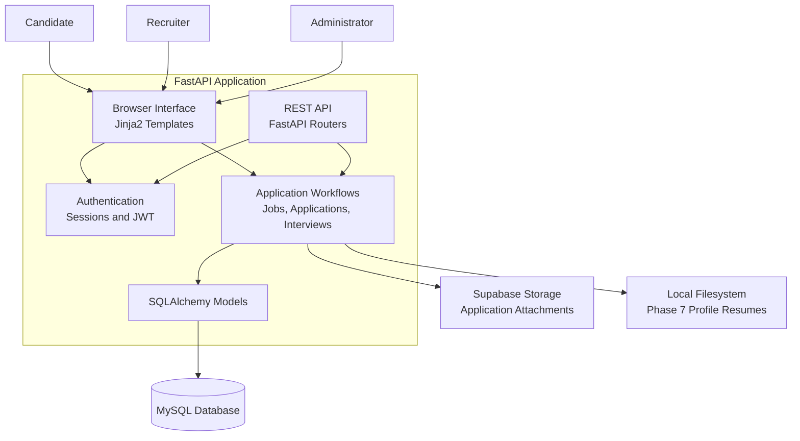

# System Architecture

The Sagniq Enterprise Recruitment & Applicant Tracking System
uses a FastAPI backend with a server-rendered browser interface,
REST API endpoints, MySQL persistence and document storage.

## Architecture Diagram

## Main Components

- **Browser Interface:** Jinja2 templates provide the user-facing pages.
- **REST API:** FastAPI routers expose application endpoints.
- **Authentication:** Browser sessions and JWT-based API authentication.
- **Business Workflows:** Job, application and interview operations.
- **Database:** MySQL accessed through SQLAlchemy.
- **Application Documents:** Supabase Storage.
- **Phase 7 Profile Resumes:** Local filesystem storage.

## Important Storage Distinction

The application attachment workflow and Phase 7 profile-resume
workflow use different storage backends. They should not be
treated as one unified document-storage system.
